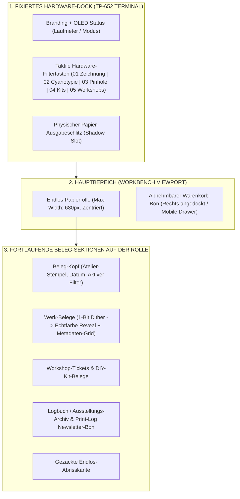
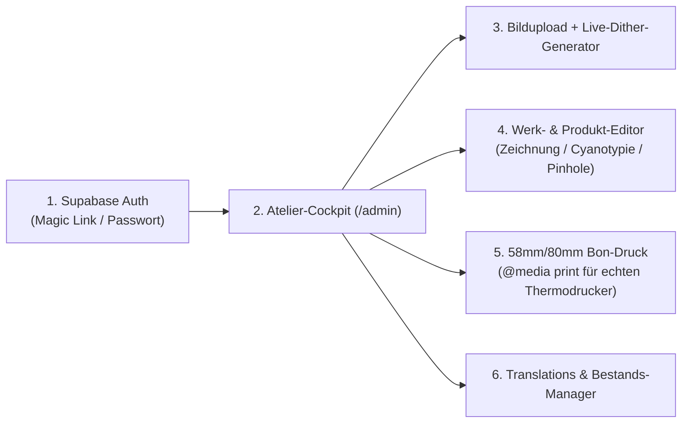

# 02 – Technische Architektur & UI/UX-Spezifikation (Thermodrucker-System)

**Rolle:** Creative Tech & Supabase Architect  
**Basis:** `/context/brand-identity.md` & `/concept/01-artist-benchmarks.md`  
**Ziel:** Vollständiges Design-System, Komponenten-Spezifikation, Dithering-Engine und `/admin`-Architektur für `amzeichnen.ch`.

---

## 1. Design-System: „Thermal Printer / Receipt Brutalism“

Das Interface von `amzeichnen.ch` bricht bewusst mit konventionellen E-Commerce-Templates. Die gesamte Webseite verhält sich wie ein **physisches Endlos-Thermodrucker-Terminal (`TP-652 CONTINUOUS`)** auf dem Arbeitstisch des Künstlers.

### 1.1 Farb-Tokens (CSS Custom Properties)

```css
:root {
  /* --- THERMOPAPIER (LIGHT / STANDARD-MODUS) --- */
  --thermal-paper: #F4F4F0;        /* Warmes, leicht raues Thermopapier */
  --thermal-paper-bright: #FAF7EE; /* Frisches Papier direkt am Druckkopf */
  --thermal-ink: #141414;          /* Reagierte Thermo-Schwarztinte (Kohlenstoff) */
  --thermal-ink-faded: #5A5852;    /* Sekundäre Metadaten / gealterter Druck */
  --thermal-border: #141414;       /* Harte 1px solid Tabellen- & Belegkanten */
  --thermal-rule-muted: #D5D3C8;   /* Feine Hilfslinien im Datenblatt */

  /* --- HARDWARE-GEHÄUSE (TEENAGE ENGINEERING INSPIRATION) --- */
  --device-shell: #D6D7D2;         /* Eloxiertes / pulverbeschichtetes Industriegrau */
  --device-shell-dark: #B8B9B2;    /* Gehäusekante / Schattenfuge */
  --device-bezel: #23262B;         /* Ausgabeschlitz & Tasten-Einfassung */
  --device-accent: #FF5C35;        /* Signal-Orange für primäre Kauf-/Feed-Aktionen */
  --device-warning: #F3B336;       /* Amber-Gelb für Limitierungen & Drop-Badges */
  --device-lcd-bg: #1B221D;        /* Retro-OLED-Hintergrund */
  --device-lcd-text: #62D681;      /* Phosphor-Grün für Statusanzeige & Laufmeter */

  /* --- ANALOGE KUNST-AKZENTE (BEI ENTWICKLUNG / HOVER) --- */
  --cyanotype-blue: #0D3B66;       /* Tiefes Preussischblau für Cyanotypie-Zustände */
  --kintsugi-gold: #D4AF37;        /* Blattgold-Akzent für Relief- & Unikat-Badges */
  --workbench-bg: #0D0F12;         /* Dunkle Schneidematte / Werkbank im Hintergrund */
}

/* --- DUNKELKAMMER-MODUS (INVERTED DARK MODE) --- */
[data-theme="darkroom"] {
  --thermal-paper: #121316;        /* Schwarzes Fotokarton-Papier / Negativ-Look */
  --thermal-paper-bright: #181A1E;
  --thermal-ink: #EAE8E1;          /* Silberhalogenid-Weiss */
  --thermal-ink-faded: #8C8A82;
  --thermal-border: #3A3D45;
  --device-accent: #E03C28;        /* Dunkelkammer-Sicherheitslicht (Rot/Orange) */
}
```

### 1.2 Typografie-System (Strikte Monospace-Hierarchie)

Alle Schriften sind dicktengleich (Monospace), damit Tabellen, Preise, ASCII-Rahmen und technische Spezifikationen wie auf einem echten Matrix-/Thermodrucker exakt in Spalten fluchten.

| Token | Schriftart | Verwendung | CSS-Specs |
| :--- | :--- | :--- | :--- |
| `--font-ui` | **JetBrains Mono** / **Space Mono** | Hardware-Tasten, Navigation, Filter, Preisschilder, Admin-Panel | `font-weight: 400, 700; letter-spacing: -0.02em;` |
| `--font-receipt` | **Courier Prime** / **Space Mono** | Laufender Kassenbon-Text, Werk-Metadaten, Echtheitszertifikat | `font-size: 12px–14px; line-height: 1.45;` |
| `--font-lcd` | **VT323** | OLED-Statusdisplay im Gehäuse (`READY`, `LENGTH: 1.84m`, `203 DPI`) | `font-size: 18px; letter-spacing: 0.08em; text-transform: uppercase;` |

### 1.3 Rahmen, Perforationen & Gezackte Abrisskanten

* **Tabellen-Brutalismus:** Keine abgerundeten Karten (`border-radius: 0px` auf dem gesamten Papierstreifen). Alle Metadaten-Zellen nutzen `border: 1px solid var(--thermal-ink)`.
* **Gestrichelte Perforationslinien (`.perforation-line`):**
  ```css
  .perforation-line {
    height: 1px;
    width: 100%;
    background-image: repeating-linear-gradient(
      to right,
      var(--thermal-ink) 0,
      var(--thermal-ink) 6px,
      transparent 6px,
      transparent 12px
    );
    margin: 12px 0;
  }
  ```
* **Gezackte Abrisskante (`.serrated-edge-bottom` & `.serrated-edge-top`):**
  Über ein wiederholtes Inline-SVG-Maskenmuster (`14px` Zahnbreite, `8px` Zahnhöhe) erhält das Ende der Papierrolle sowie der abreissbare Warenkorb-Bon eine messerscharfe Zickzack-Kante:
  ```css
  .serrated-bottom {
    --tooth-w: 14px;
    --tooth-h: 8px;
    background: linear-gradient(135deg, var(--thermal-paper) 50%, transparent 50%),
                linear-gradient(225deg, var(--thermal-paper) 50%, transparent 50%);
    background-position: bottom left;
    background-size: var(--tooth-w) var(--tooth-h);
    background-repeat: repeat-x;
    height: var(--tooth-h);
    width: 100%;
  }
  ```

---

## 2. Layout-Architektur & Komponenten



### 2.1 Komponente A: Das Hardware-Dock & Filter-Tasten (Header)
Am oberen Bildschirmrand sitzt das flache „Druckergehäuse“ (`#printer-device`).
* **Links:** Modell-Typenschild `AMZEICHNEN.CH // TP-652 LAB TERMINAL`.
* **Mitte:** Grünes Retro-OLED-Display. Es zeigt live:
  * Den aktuellen Druckerstatus (`STATUS: BELICHTUNG BEREIT` oder `PRINTING...`).
  * Den dynamischen **Rollen-Kilometerzähler** (`ROLLE: 1.42m`), der beim Scrollen in Echtzeit hochzählt (`scrollTop * 0.000264` Meter).
* **Rechts:** Hardware-Kippschalter für:
  * `🔊 MOTOR-SOUND` (Web Audio API Synthesizer für dezentes Schrittmotor-Rattern beim Filtern/Warenkorb-Druck).
  * `◐ DUNKELKAMMER` (Light/Dark-Mode Toggle).
  * `DE / EN` (Sprachumschalter, gekoppelt an die Supabase `translations`-Tabelle).
* **Taktile Filter-Leiste:** 6 physisch gestaltete Tasten mit `border-b-2`, die beim Anklicken um `2px` einsinken und die Papierrolle neu auswerfen:
  * `[ 00 // ALLE BELEGE ]`
  * `[ 01 // FARBSTIFT-ORIGINALE ]`
  * `[ 02 // CYANOTYPIE & EDELDRUCK ]`
  * `[ 03 // PINHOLE & SOLARGRAPHIE ]`
  * `[ 04 // DIY-KITS & ZINES ]`
  * `[ 05 // WORKSHOPS & AUSSTELLUNGEN ]`

### 2.2 Komponente B: Der Werk-Beleg im Feed (`<ArtworkReceiptItem />`)
Jedes Kunstwerk auf der Rolle ist wie ein eigenständiger technischer Labor-Beleg aufgebaut:

```text
================================================================
ID: CYA-2026-064                     TIMESTAMP: 2026-06-21 14:22
SERIE: CYANOTYPIE & EXPERIMENTELL    STATUS: [ UNIKAT VERFÜGBAR ]
----------------------------------------------------------------
+--------------------------------------------------------------+
|                                                              |
|        [ 1-BIT THERMO-DITHER BILD (384px RASTER) ]           |
|                                                              |
|     (Hover / Tap: "Chemische Entwicklung" -> Echtfarbe)      |
|                                                              |
|  [ 👁 VOLLBILD / LEUCHTKASTEN ]   [ ◐ 1-BIT / FARBE TOGGLE ] |
+--------------------------------------------------------------+
TITEL: GOLDADER IM PREUSSISCHBLAU
----------------------------------------------------------------
MEDIUM         | Cyanotypie-Sonnendruck mit 24k Kintsugi-Gold
PAPIER         | 300 g/m² Arches Aquarelle Bütten (Säurefrei)
FORMAT         | 148 × 210 mm (A5) // Ungerahmt
BELICHTUNG     | 16 Min 40 Sek (Alpensonne Luzern, UV-Index 7)
EDITION        | 1/1 Original-Unikat (Handsigniert + Dual-CoA)
----------------------------------------------------------------
PREIS (INKL. VERSAND CH):                            290.00 CHF
[ ||||||| |||| ||| |||||| ||| ]     [ + AUF DEN BON DRUCKEN -> ]
================================================================
```

* **Verkaufte Werke (`status = 'sold'`):** Bleiben im Archiv-Modus sichtbar, tragen aber quer über der Preiszeile einen leicht rotierten (`-2deg`) Rahmenstempel `[ VERKAUFT // ARCHIVIERT – PRIVATSAMMLUNG CH ]` statt des Kauf-Buttons.

### 2.3 Komponente C: Der abreissbare Warenkorb-Bon (`<DetachableCartSlip />`)
Statt eines generischen Slide-Over-Drawers hängt am rechten oberen Bildschirmrand ein zweiter, schmalerer **Kassenbon-Streifen (`width: 320px`)** aus einer eigenen kleinen Abreiss-Schiene.
* **Dynamischer Ausdruck:** Klickt der Nutzer bei einem Werk, einem DIY-Lochkamera-Kit oder einem Workshop auf `[ + AUF DEN BON DRUCKEN ]`, rattert der Warenkorb-Bon ein Stück nach unten und fügt eine neue Position im Kassenbon-Stil an:
  ```text
  POS 01: CYA-2026-064 (UNIKAT)        290.00 CHF
  POS 02: KIT-PIN-01 (ORIGAMI KAMERA)   35.00 CHF
  -----------------------------------------------
  VERSAND (SCHWEIZER POST / LABOR-PACK)  0.00 CHF
  TOTAL (CHF)                          325.00 CHF
  -----------------------------------------------
  INKL. DUAL-RECEIPT ECHTHEITSZERTIFIKAT
  ```
* **Abreiss-Checkout-Interaktion:**
  * Unten am Warenkorb-Bon sitzt der signal-orange Button **`[ ✂ BON ABREISSEN & MIT TWINT / KARTE ZAHLEN ]`**.
  * Beim Klick (oder einer horizontalen Swipe-Geste entlang der Perforationslinie) spielt eine **CSS-Abreiss-Animation** (`transform: translateY(35px) rotate(2.5deg)`) ab, begleitet vom Geräusch abreissenden Papiers, und leitet nahtlos zur **Stripe Checkout Session (mit aktivierter Schweizer TWINT- & Kreditkarten-Zahlung)** weiter.

---

## 3. Technische Umsetzung des Dithering- & „Entwicklungs“-Effekts

Die Bilddarstellung ist das Herzstück der künstlerischen Vision: Im Ruhezustand wirkt der Feed wie ein monochromer 1-Bit-Kassenbon; bei Interaktion „entwickelt“ sich die volle Farbtiefe (Preussischblau, Polychromos-Pigmente, Blattgold).

### 3.1 Zweistufige Pipeline (Performance + Ästhetik)

Damit die Seite trotz hochauflösender Kunstwerke unter **1 Sekunde Ladezeit (LCP)** bleibt, nutzen wir eine hybride Pipeline:

1. **Vorberechnetes 1-Bit-Dither-Bild (`image_dither_url`):**
   * Beim Bildupload im `/admin`-Panel wird jedes Kunstwerk auf **384 Pixel Breite** (der exakten Druckkopf-Auflösung eines 58mm-Thermodruckers bei 203 DPI: $48\,\text{mm} \times 8\,\text{dots/mm} = 384\,\text{dots}$) herunterskaliert und mit dem **Atkinson-Dithering-Algorithmus** (bekannt vom Original Apple Macintosh) oder einer **4×4 Bayer-Matrix** in ein echtes 1-Bit-PNG umgewandelt.
   * Dateigrösse pro Werk: nur **8 KB bis 18 KB**!
   * Im CSS wird dieses Bild mit `image-rendering: pixelated;` dargestellt, wodurch im Feed echte, knackscharfe Thermopapier-Rasterpunkte sichtbar sind.

2. **Interaktiver Übergang („Chemische Entwicklung“ zu Echtfarbe):**
   * Sobald das Werk in den Viewport scrollt, wird das hochauflösende Farbbild (`image_color_url`, WebP) im Hintergrund (`loading="lazy"`) vorgeladen.
   * Bei **Hover (Desktop)**, **Tap auf `[ BELICHTEN ]` (Mobile)** oder beim Öffnen des **Leuchtkastens (Lightbox)** steuert ein **WebGL Fragment-Shader (mit CSS/Canvas-Fallback)** den Übergang.

### 3.2 Produktionsreifer WebGL-Shader für die „Bild-Entwicklung“

Statt einer flachen `opacity`-Überblendung entwickelt sich das Farbbild organisch entlang der Tonwerte und einer Bayer-Dither-Schwelle (wie eine Cyanotypie im Wasserbad):

```glsl
// Fragment Shader: Thermal 1-Bit Dither to Full-Color Chemical Reveal
precision mediump float;

varying vec2 vUv;
uniform sampler2D uColorTexture;
uniform float uRevealProgress; // 0.0 = 1-Bit Thermodruck, 1.0 = Volle Echtfarbe
uniform vec2 uResolution;      // z.B. vec2(384.0, 512.0)

// 4x4 Bayer Matrix Funktion
float bayer4x4(vec2 pos) {
  int x = int(mod(pos.x, 4.0));
  int y = int(mod(pos.y, 4.0));
  int index = x + y * 4;
  float m = 0.0;
  if (index == 0) m = 0.0; else if (index == 1) m = 8.0; else if (index == 2) m = 2.0; else if (index == 3) m = 10.0;
  else if (index == 4) m = 12.0; else if (index == 5) m = 4.0; else if (index == 6) m = 14.0; else if (index == 7) m = 6.0;
  else if (index == 8) m = 3.0; else if (index == 9) m = 11.0; else if (index == 10) m = 1.0; else if (index == 11) m = 9.0;
  else if (index == 12) m = 15.0; else if (index == 13) m = 7.0; else if (index == 14) m = 13.0; else if (index == 15) m = 5.0;
  return (m + 0.5) / 16.0;
}

void main() {
  // 1. Pixel-Quantisierung im 1-Bit-Modus (384 Dots Breite wie Thermodruckkopf)
  float pixelScale = mix(384.0, uResolution.x, smoothstep(0.0, 0.7, uRevealProgress));
  vec2 pixelatedUv = floor(vUv * pixelScale) / pixelScale;

  vec4 colorSample = texture2D(uColorTexture, mix(pixelatedUv, vUv, uRevealProgress));

  // 2. Luminanz berechnen
  float luma = dot(colorSample.rgb, vec3(0.299, 0.587, 0.114));

  // 3. 1-Bit Thermodruck-Farben (#141414 Tinte auf #F4F4F0 Thermopapier)
  float threshold = bayer4x4(gl_FragCoord.xy);
  vec3 thermalInk = vec3(0.078, 0.078, 0.078);
  vec3 thermalPaper = vec3(0.957, 0.957, 0.941);
  vec3 ditheredRgb = luma < threshold ? thermalInk : thermalPaper;

  // 4. Organische Entwicklung: Dunkle Pigmente (Preussischblau / Schatten) erscheinen zuerst
  float organicWave = smoothstep(
    0.0,
    1.0,
    (uRevealProgress * 1.4) - (luma * 0.4)
  );

  vec3 finalColor = mix(ditheredRgb, colorSample.rgb, organicWave);
  gl_FragColor = vec4(finalColor, 1.0);
}
```

### 3.3 Leichtgewichtiger CSS/Canvas-Fallback (Ohne WebGL)
Für Geräte mit aktiviertem `prefers-reduced-motion` oder älteren Browsern legt sich das vorberechnete `` exakt über das ``. Bei `:hover` oder `.is-developed` animiert eine CSS-Maske (`mask-image: linear-gradient(...)`) den Übergang von oben nach unten wie ein durchlaufender Scanner/Entwicklungsstreifen.

---

## 4. Supabase Storage & Security-Architektur

### 4.1 Supabase Storage Bucket-Struktur

Wir richten in Supabase Storage zwei klar getrennte Buckets ein:

1. **`public-artworks` (Public Bucket, CDN-cached):**
   * Pfad-Konvention:
     * `/artworks/{artwork_code}/dither_384.png` (1-Bit Thermodruck-Vorschau für den Feed)
     * `/artworks/{artwork_code}/color_feed_800.webp` (Optimierte Farbversion für Hover-Entwicklung)
     * `/artworks/{artwork_code}/color_hd_2000.webp` (Hochauflösende Lightbox-Ansicht mit Wasserzeichen/Metadaten)
     * `/products/{sku}/...` (Bilder für DIY-Kits & Zines)
     * `/exhibitions/{slug}/...` (Ausstellungs- & Atelier-Fotos)
2. **`private-print-masters` (Private Bucket, nur Admin-Zugriff):**
   * Enthält unkomprimierte Druckdateien (TIFF/PNG für Fine-Art-Prints), druckfertige PDF-Schnittbögen der DIY-Lochkameras sowie generierte PDF/HTML-Belege für das physische Echtheitszertifikat.

### 4.2 Row Level Security (RLS) Konzept
* **Öffentlicher Lesezugriff (`SELECT`):** Anonyme Webseitenbesucher (`anon`) dürfen ausschliesslich Datensätze lesen, bei denen `is_published = true` gesetzt ist.
* **Admin-Vollzugriff (`ALL`):** Nur authentifizierte Nutzer (`authenticated`), deren `auth.uid()` in der Tabelle `admin_users` hinterlegt ist (oder deren JWT-Rolle `admin` entspricht), dürfen Datensätze erstellen, bearbeiten, löschen oder unveröffentlichte Entwürfe sehen.

---

## 5. Spezifikation des Admin-Dashboards (`/admin`)

Das `/admin`-Interface ist direkt in die Web-Applikation integriert (`amzeichnen.ch/admin`) und folgt derselben aufgeräumten **Hardware-Labor-Ästhetik** – optimiert für schnelles Arbeiten im Atelier (Desktop & iPad/Smartphone).



### 5.1 Login & Authentifizierung
* Login über `supabase.auth.signInWithPassword()` oder `signInWithOtp()` (Magic Link an Simons Atelier-Mailadresse).
* Nach erfolgreichem Login erscheint auch auf der öffentlichen Hauptseite oben im Hardware-Gehäuse ein kleiner oranger Schalter **`[ ⚙️ ADMIN-MODUS AKTIV ]`**, mit dem Simon jedes Werk direkt im Feed per Schnellklick bearbeiten kann.

### 5.2 Der „Atelier-Uploader“ mit integriertem Dither-Labor
Zieht Simon ein Foto eines neuen Kunstwerks in die Dropzone, läuft im Browser automatisch folgender Prozess ab:
1. **Automatische Bild-Skalierung (Client-Side Canvas):**
   * Erzeugt `color_hd_2000.webp` (max. 2000px Kantenlänge, 88% WebP) und `color_feed_800.webp` (800px Kantenlänge, 82% WebP).
2. **Interaktive 1-Bit-Dither-Kalibrierung:**
   * Da eine dunkle Cyanotypie andere Schwellenwerte braucht als eine zarte A6-Farbstiftzeichnung, bietet der Uploader **3 Live-Schieberegler**:
     * `DITHER-MODUS`: `[ Atkinson (Empfohlen) ]` | `[ Bayer 4x4 (Technisch) ]` | `[ Floyd-Steinberg (Fein) ]`
     * `THERMO-KONTRAST`: `-50%` bis `+50%`
     * `BELICHTUNGS-SCHWELLE (THRESHOLD)`: `0` bis `255`
   * Simon sieht in Echtzeit das 384px breite 1-Bit-Ergebnis und speichert mit einem Klick alle drei Bildvarianten parallel in den Supabase Storage Bucket `public-artworks`.

### 5.3 Live-Vorschau des Kassenbon-Eintrags & Physischer Thermodruck (`@media print`)
* **Split-Screen-Editor:** Links pflegt Simon die Felder (Titel, Serie, Technik, Belichtungszeit, Papiergewicht, Preis, Bestand), rechts rendert das Dashboard in Echtzeit den fertigen Kassenbon inklusive automatisch generiertem **SVG-QR-Code** (`https://amzeichnen.ch/?id=K0064`).
* **One-Click Physischer Atelier-Bon-Druck:**
  * Im Admin-Panel gibt es bei jedem Werk und jeder Bestellung den Button **`[ 🖨️ AUF THERMODRUCKER AUSGEBEN (58mm / 80mm) ]`**.
  * Über ein dediziertes Print-Stylesheet (`@page { size: 80mm auto; margin: 0; }`) kann Simon auf einem per USB/Bluetooth angeschlossenen Kassenbon-Drucker (z. B. Epson TM-T20III oder Munbyn/Phomemo) sofort den physischen Beipackzettel, das Versandetikett und das „Ephemeral Receipt“-Zertifikat ausdrucken!

### 5.4 Bestands-, Workshop- & Übersetzungs-Verwaltung
* **Quick-Status-Toggle:** In einer kompakten Tabellenansicht aller 650+ Werke kann Simon per Klick den Status zwischen `available` (Verfügbar), `reserved` (Reserviert bei Ausstellung), `sold` (Verkauft / Archiv) und `draft` (Entwurf) umschalten.
* **Übersetzungs-Matrix (`translations`):** Ein Tab im Admin-Panel lädt alle UI-Labels und Systemtexte aus der `translations`-Tabelle (`de`, `en`), sodass Beschriftungen auf dem Kassenbon jederzeit ohne Code-Deployment angepasst werden können.
