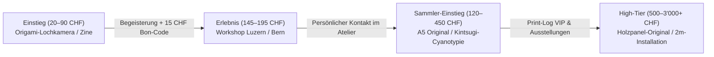
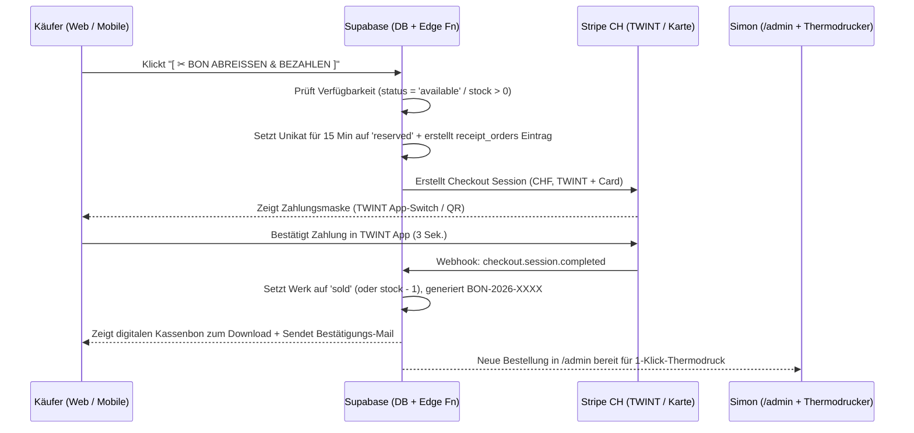

# 03 – Geschäftsmodell, Pricing & E-Commerce-Architektur (Schweiz / CHF)

**Rolle:** Art Business & Monetization Strategist  
**Basis:** `/context/brand-identity.md`, `/concept/01-artist-benchmarks.md`, `/concept/02-ui-thermo-spec.md`  
**Ziel:** Realistisches, profitables und skalierbares Geschäftsmodell für `amZeichnen.ch` im Schweizer Markt (CHF).

---

## Executive Summary: Das 4-Säulen-Atelier-Modell

Ein reines Online-Portfolio verkauft selten von allein hochpreisige Kunst – und ein reiner Unikat-Shop leidet unter schwankenden monatlichen Einnahmen. Das Geschäftsmodell von `amZeichnen.ch` kombiniert deshalb **vier sich gegenseitig verstärkende Erlössäulen**:

1. **Säule 1 – Entry-Level (DIY-Kits, Zines & Mini-Prints | 20–90 CHF):** Niedrigschwellige Produkte mit hohem Kultfaktor, die Neukunden gewinnen, die Marke verbreiten und laufenden Basis-Cashflow generieren.
2. **Säule 2 – Mid-Tier (Kuratierte Originale A6/A5 & Editionen | 120–450 CHF):** Das Herzstück aus dem 650+ Werke umfassenden Zeichnungs-, Cyanotypie- und Solargraphie-Archiv.
3. **Säule 3 – Live-Erlebnis (Workshops in Luzern/Bern | 145–195 CHF / Ticket bzw. B2B):** Planbare, hochmargige Einnahmen und der stärkste Vertrauensanker für spätere Kunstkäufe.
4. **Säule 4 – High-Tier (Grossformate auf Holz, 2m-Cyanotypien & Pop-up-Ausstellungen | 500–3'000+ CHF):** Leuchtturm-Positionen für Sammler, Architekturbüros und Kulturinstitutionen.

---

## 1. Die Produkt-Treppe: Pricing, Herstellkosten & Margen (in CHF)

> [!NOTE]
> **Mehrwertsteuer-Hinweis Schweiz:** Solange der Jahresumsatz unter 100'000 CHF liegt, ist `amZeichnen.ch` von der Schweizer MWST-Pflicht befreit (`Art. 10 Abs. 2 Bst. a MWSTG`). Auf dem Kassenbon wird transparent ausgewiesen: `MWST-BEFREIT (KLEINUNTERNEHMEN GEM. CH-MWSTG)`. Dadurch bleibt die volle Bruttomarge im Atelier.

### 1.1 Stufe 1: Entry-Level (20 – 90 CHF) – „Labor-Einstieg & Impulskauf“

Diese Produkte sind ideal für Instagram-Besucher, Geschenk-Käufer und Fotografie-/Design-Enthusiasten. Sie benötigen **wenig laufende Arbeitszeit pro Stück** (da vorproduzierbar in Kleinauflagen von 25–100 Stück).

| Produkt / SKU | Beschreibung & Spezifikation | VK (CHF) | Material & Druck (CHF) | Verpackung & Dual-Bon (CHF) | Stripe / TWINT Gebühr (~1.8%) | Netto-Marge (CHF / %) |
| :--- | :--- | :---: | :---: | :---: | :---: | :---: |
| **Postkarten- & Fragment-Set** (`SET-POST-01`) | 5er-Set auf 350g/m² Naturkarton + 1 echter Cyanotypie-Teststreifen im Pergamin-Beutel | **24.00** | 3.20 | 1.80 | 0.75 | **18.25 CHF (76%)** |
| **Atelier-Zine / Prozess-Log** (`ZINE-001`) | 32 Seiten, Fadenheftung/Klammerung, Monospace-Layout (Solargraphie / Pinhole / Zeichnung), nummeriert | **29.00** | 4.80 | 1.80 | 0.85 | **21.55 CHF (74%)** |
| **Origami-Lochkamera-Kit A6** (`KIT-PIN-A6`) | Vorgestanzter 350g/m² Lichtschutz-Karton, 0.22mm Messing-Blende, 6 Blatt Ilford Papier, Anleitung + `map.solargrafie.ch` Token | **45.00** | 6.90 | 2.20 | 1.10 | **34.80 CHF (77%)** |
| **Solargraphie-Doppel-Set** (`KIT-SOL-02`) | 2× fertig präparierte, mattschwarze Alu-Lochkameras + Wetter-Tape + QR-Token für digitalen Scan- & Invertier-Service im Atelier | **58.00** | 7.50 | 2.90 | 1.35 | **46.25 CHF (80%)** |
| **Cyanotypie-Starter-Labor** (`KIT-CYA-01`) | 2× 100ml Braunglas-Flaschen (Lösung A+B trocken), 10 Bögen Büttenpapier A5, Schaumpinsel, Thermo-Rezeptkarte | **68.00** | 11.40 | 3.20 | 1.50 | **51.90 CHF (76%)** |
| **Mini-Original / Drop-Bogen A6** (`DRW-A6-DROP`) | Kleines Farbstift-Original oder offene A5-Cyanotypie (Kuratiertes Einstiegs-Unikat inkl. Dual-Receipt CoA) | **85.00** | 3.50 | 2.50 | 1.80 | **77.20 CHF (91%)** |

---

### 1.2 Stufe 2: Mid-Tier (120 – 450 CHF) – „Sammler-Kern & Workshops“

Diese Preisklasse ist im Schweizer Markt der **Sweet Spot für spontane Kunstkäufe ohne lange Bedenkzeit**. Aus dem bestehenden Bestand von über 650 Werken werden monatlich kuratierte Serien („Bögen“ à 10–15 Werke) freigeschaltet.

| Produkt / Werk-Kategorie | Beschreibung & Spezifikation | VK (CHF) | Material / Rahmen / Raum (CHF) | Versand & Dual-CoA (CHF) | Zahlungs-Gebühr (CHF) | Netto-Erlös (CHF / %) |
| :--- | :--- | :---: | :---: | :---: | :---: | :---: |
| **Farbstift-Original A6 (Unikat)** | Polychromos/Pigment auf 250g/m² Bütten (Serien z.B. *Organische Formstudien*, *Farbstudien*), inkl. Passepartout-Option | **135.00** | 6.00 | 5.20 | 2.70 | **121.10 CHF (90%)** |
| **Solargraphie Fine-Art-Edition A4** | Limitierte 10er-Edition auf Hahnemühle Photo Rag 308g/m², handsigniert, inkl. Koordinaten-Beleg | **180.00** | 18.00 | 6.50 | 3.50 | **152.00 CHF (84%)** |
| **Farbstift-Original A5 (Unikat)** | Dichte mehrschichtige Zeichnung (z.B. *Resonanzen & Schwingungen*, *Gesten*), ungerahmt oder im Schwebepassepartout | **210.00** | 9.00 | 6.50 | 4.10 | **190.40 CHF (91%)** |
| **Cyanotypie + 24k Kintsugi-Gold (Unikat)** | Sonnendruck auf 300g/m² Arches Bütten, handveredelt mit echtem Blattgold (z.B. Werk `K0064`) | **290.00** | 16.00 | 7.50 | 5.50 | **261.00 CHF (90%)** |
| **3D-Papierrelief & Blattgold-Objekt** | Geformtes Büttenpapier mit Goldblatt auf Holzpanel oder im tiefen Schattenfugen-/Objektrahmen (z.B. Werk `K0018`) | **420.00** | 45.00 | 12.00 | 7.80 | **355.20 CHF (85%)** |
| **Ticket Halbtages-Workshop (4 Std.)** | Teilnahme an *Cyanotypie im Freien* oder *Pinhole-Labor* in Luzern/Bern inkl. Material & 3–5 eigener Werke | **165.00 – 185.00** | 22.00 (pro TN) | 0.50 (Bon-Ticket) | 3.30 | **~149.20 CHF (85%)** |

---

### 1.3 Stufe 3: High-Tier (500 – 3'000+ CHF) – „Raumkunst, Holzpanels & Installationen“

Hier liegt der Fokus auf architektonischer Wirkung, hochwertiger Montage (Holzpanels, Schweizer Massivholzrahmen mit Museumsglas) und Exklusivität.

| Werk-Kategorie | Beschreibung & Format | Preisspanne (CHF) | Herstellung / Rahmung / Logistik | Zielgruppe |
| :--- | :--- | :---: | :--- | :--- |
| **Grossformat-Farbstift auf Holzpanel** | Mehrschichtige Originalzeichnung, kaschiert/gearbeitet auf verzugsfreiem Birkenholz-Körper (A3 bis 50×70 cm), versiegelt | **650 – 1'400 CHF** | ~85 – 160 CHF (Schreiner-Panel + Firnis) | Kunstsammler, Praxen, Kanzleien |
| **Kuratiertes Serien-Triptychon / 4er-Block** | 3 bis 4 perfekt aufeinander abgestimmte Originale aus einer Serie, gemeinsam gerahmt in Schweizer Eiche/Schwarzesche mit entspiegeltem Museumsglas | **950 – 1'650 CHF** | ~180 – 260 CHF (Rahmenbauer CH) | Wohnräume, Interior-Design-Kunden |
| **Lebensgrosse 2-Meter-Cyanotypie** | Monumentaler Sonnendruck (`ca. 65 × 200 cm` oder `100 × 220 cm`) auf schwerem Baumwoll-Papier oder Leinen, mit Magnet-Holzleisten oder als Raum-Installation | **1'800 – 3'200 CHF** | ~190 – 320 CHF (Grossformat-Träger + Holzleisten) | Architekturbüros, Lobbys, Offspaces, Sammler |
| **Auftrags-Solargraphie („Site-Specific Time Capture“)** | Installation von 3 Lochkameras am Gebäude/Garten des Auftraggebers für 6 Monate -> Auswertung + 1 Grossformat-Unikat + 5er-Edition für das Unternehmen | **2'200 – 3'800 CHF** | ~250 CHF + 2 Vor-Ort-Termine | Firmenjubiläen, Neubauten, Kulturhäuser |

---

## 2. E-Commerce & Zahlungsabwicklung („Kassenbon-Checkout“)

### 2.1 Warum TWINT via Stripe für `amZeichnen.ch` entscheidend ist
In der Schweiz werden über **65–75 % aller spontanen Online-Käufe auf dem Smartphone über TWINT** abgewickelt – insbesondere wenn der Nutzer von Instagram (`@simon.amZeichnen`) kommt und keine Kreditkarte abtippen möchte.

* **Technischer Stack:**
  * **Frontend:** Abreissbarer Warenkorb-Bon auf `amzeichnen.ch`.
  * **Backend:** Supabase Edge Function (`supabase/functions/checkout/index.ts`), die eine **Stripe Checkout Session** in `CHF` mit `payment_method_types: ['twint', 'card']` erzeugt.
  * **Warum Stripe Hosted Checkout / Embedded Checkout?**
    * Sofortige **TWINT-QR-Code-Anzeige** am Desktop und **Direkt-App-Switch** zur TWINT-App auf dem iPhone/Android.
    * Automatische Adress-Validierung für die Schweiz (PLZ/Ort).
    * Keine eigene PCI-DSS-Last.

### 2.2 Automatisierter Checkout- & Bestands-Flow (Zero-Overselling für Unikate)

### 2.3 Option „Atelier-Reservierung / Vor-Ort-Kauf“ (Für Ausstellungen & Hochpreis-Werke)
Bei Werken ab **800 CHF** oder während einer **Pop-up-Ausstellung** bietet der Beleg neben dem Direktkauf einen zweiten Button:
* **`[ ATELIER-BESICHTIGUNG / RESERVIERUNG (48H) ]`**
* Und vor Ort in der Ausstellung: Jedes Werk hat auf dem physischen Thermobon-Preisschild einen **QR-Code**, der direkt die vorausgefüllte TWINT-/Stripe-Zahlung für genau dieses Werk auf dem Smartphone des Ausstellungsbesuchers öffnet. Der Besucher zahlt vor Ort in 10 Sekunden per TWINT, und Simons mobiler Thermodrucker an der Theke spuckt live den Kaufbeleg aus!

---

## 3. Versandlogik & Verpackungskonzept (Schweizerische Post)

### 3.1 Klare Versandkosten-Regel (Conversion-Optimiert)
Unklare Versandkosten sind der häufigste Kaufabbruchgrund. Deshalb gilt auf `amZeichnen.ch` eine **ultrasimple Regel**:
* **Ab 90 CHF Bestellwert (also für ALLE Originale, Editionen und Workshops): `0.00 CHF VERSAND (KOSTENLOS IN DER SCHWEIZ)`.** (Die 5–9 CHF Portokosten sind bereits in der 85–91% Marge einkalkuliert).
* **Unter 90 CHF (Einzelne Zines, Postkarten, DIY-Kits): Pauschal `4.90 CHF` (A-Post Plus mit Tracking).**

### 3.2 Die 3 Verpackungs-Standards („Labor-Sendung“)

1. **Standard 1: Flach-Sendung A5/A4 (`flat_a5` / `flat_a3` – bis 2 cm Dicke):**
   * *Inhalt:* Zines, Origami-Lochkamera-Kits, ungerahmte A6/A5/A4-Originale & Cyanotypien.
   * *Material:* Steife Buchverpackung / Vollpappe-Versandtasche (knicksicher bis 50 kg Kantenlast) + 2 mm Graukarton-Verstärkung + säurefreies Pergaminpapier + Thermo-Banderole.
   * *Post-Tarif:* **Brief A-Post Plus (Midibrief B4)** inkl. elektronischer Sendungsverfolgung (`3.40 CHF` bis `5.30 CHF`).

2. **Standard 2: Schwerlast-Versandrolle (`tube_oversize` – für Grossformate & 2m-Cyanotypien):**
   * *Inhalt:* Grossformatige Papierarbeiten und lebensgrosse 2-Meter-Cyanotypien.
   * *Material:* Spiralgewickelte Hartpapierhülse (Wandstärke 4 mm, Durchmesser 100 mm, damit das schwere Büttenpapier nicht zu eng gerollt wird), eingeschlagen in Seidenpapier, beide Enden mit Metalldeckel und Kassenbon-Siegelstreifen verschlossen.
   * *Post-Tarif:* **PostPac Priority** (`9.00 CHF` bis 100 cm Länge) bzw. **Sperrgut Priority** (`29.00 CHF` über 100 cm Länge).

3. **Standard 3: Atelier-Übergabe / Holz-Box (`wood_crate` / `pickup_only`):**
   * *Inhalt:* Gerahmte Werke mit Museumsglas, 3D-Blattgold-Reliefs und Holzpanels.
   * *Abwicklung:* Entweder **Persönliche Abholung im Atelier (Luzern/Bern)** inklusive Werkgespräch & Espresso oder **Spezialverpackung in Luftpolster-Kantenschutz-Karton (PostPac Fragile)**.

---

## 4. Workshop- & Ausstellungs-Modell (Luzern / Bern)

### 4.1 Kalkulation der Workshops (Unit Economics)

Workshops erfüllen eine **Doppelfunktion**: Sie bringen sofortigen, planbaren Cashflow und verwandeln Teilnehmer in begeisterte Botschafter und Sammler.

#### Kalkulationsbeispiel: Halbtages-Workshop „Cyanotypie & Sonnendruck“ oder „Pinhole-Labor“ (4 Stunden)
* **Ort:** Eigenes Atelier oder gemieteter Projektraum / Werkhof in Luzern (z. B. Neubad-Umfeld, Viscosistadt Emmenbrücke) oder Bern (z. B. PROGR, Lorraine/Breitenrain).
* **Teilnehmerzahl:** Maximal **8 Personen** (garantiert persönliche Betreuung und Labor-Atmosphäre).
* **Ticketpreis:** **175.00 CHF** pro Person.

| Position | Berechnung | Betrag (CHF) |
| :--- | :--- | ---: |
| **Brutto-Umsatz (bei 8 Teilnehmenden)** | $8 \times 175.00\,\text{CHF}$ | **+ 1'400.00 CHF** |
| **Cross-Selling vor Ort** (Erfahrungswert: 3 TN kaufen ein DIY-Kit, Zine oder kleines Original mit 15% Workshop-Rabatt) | $\varnothing$ Zusatzverkauf via TWINT-QR | **+ 180.00 CHF** |
| **Gesamteinnahmen pro Workshop-Nachmittag** | | **1'580.00 CHF** |
| *Abzgl. Materialkosten* (Büttenpapier, Chemie/Fotopapier, Fläschchen zum Mitnehmen, Rezept-Bon) | $8 \times 21.00\,\text{CHF}$ | $- 168.00\text{ CHF}$ |
| *Abzgl. Raummiete / Nebenkosten* (falls externer Raum in Bern/Luzern für ½ Tag) | Pauschal | $- 150.00\text{ CHF}$ |
| *Abzgl. Verpflegung* (Kaffee, Gebäck, Getränke) | Pauschal | $- 45.00\text{ CHF}$ |
| *Abzgl. Stripe/TWINT-Gebühren (Online-Ticketverkauf)* | ~1.8 % | $- 28.00\text{ CHF}$ |
| **Netto-Gewinn pro Workshop (für ca. 7 Std. inkl. Auf-/Abbau)** | | **= 1'189.00 CHF** |
| **Effektiver Stundensatz für Simon** | $1'189\,\text{CHF} / 7\,\text{Std.}$ | **~ 170.00 CHF / Std.** |

#### Zusatz-Hebel: B2B-Team-Events („Analoges Entschleunigungs-Labor für Teams“)
Architekturbüros, Designagenturen, IT-Firmen und Kulturabteilungen in Luzern, Bern und Zürich suchen nach aussergewöhnlichen Team-Events abseits von Standard-Kochkursen:
* **Angebot:** 3-stündiges exklusives Team-Labor (*„Vom digitalen Bildschirm in die Dunkelkammer / ans Sonnenlicht“*) für 6 bis 12 Personen.
* **Pauschalpreis:** **1'650 CHF (bis 8 Pers.)** bzw. **2'200 CHF (bis 12 Pers.)**.
* **Besonderheit:** Gemeinsam entsteht neben den Einzelwerken ein grossformatiges **Gemeinschafts-Cyanotypie-Banner** für das Büro des Kunden.

---

### 4.2 Konzept für Pop-up-Ausstellungen („Das 72-Stunden-Labor“)

Klassische Galerien verlangen **40 % bis 50 % Provision** und binden Werke über Monate. Für `amZeichnen.ch` ist das **kuratierte Pop-up-Format in Luzern und Bern** deutlich lukrativer und markenstärker:

1. **Raum-Strategie (Zwischennutzungen & Partner-Locations):**
   * Kurze Anmietung (Donnerstag bis Sonntag) von charakterstarken Räumen mit rohem Industrie- oder Atelier-Charme (in Luzern z. B. Neubad-Pool/Galerie, Industriestrasse, Viscosistadt; in Bern z. B. PROGR-Räume, Matte, Breitenrain-Offspaces oder Kooperation mit spezialisierten Design-/Buchläden und Röstereien).

2. **Szenografie im Raum (Physischer „Receipt Brutalism“):**
   * Im Raum hängen die **2-Meter-Cyanotypie-Installationen** von der Decke, während auf einem langen Arbeitstisch die **A6/A5-Farbstift-Serien**, originale **Solargraphie-Bierdosen** und das **echte Thermodrucker-Terminal** präsentiert werden.
   * Besucher können am Terminal per Knopfdruck ein zufälliges Werk-Gedicht, die Koordinaten einer Solargraphie oder ihr eigenes Ausstellungs-Ticket auf Thermopapier ausdrucken.

3. **Dramaturgie eines Pop-up-Wochenendes (Donnerstag – Sonntag):**
   * **Donnerstagabend (Preview für Print-Log-Abonnenten):** Exklusiver Vorab-Zugang für Newsletter-Leser & Sammler (erste Wahl bei neuen Original-Serien).
   * **Freitagabend (Öffentliche Vernissage & Live-Belichtung):** Vorführung einer grossformatigen Cyanotypie-Entwicklung im Wasserbad + Audio-visuelles Experiment.
   * **Samstagvormittag & -nachmittag:** 2 buchbare Kurz-Workshops (je 6–8 Plätze à 145 CHF) direkt inmitten der Ausstellung -> **die Workshop-Einnahmen (~1'800 CHF) decken bereits 100 % der gesamten Ausstellungs- und Raumkosten!** Jedes verkaufte Kunstwerk am Wochenende ist damit reiner Gewinn.
   * **Sonntag:** Finissage & „Last-Roll-Drop“ (Verkauf von kleineren Studien, DIY-Kits und Zines direkt vom Tisch).

---

## 5. Realistisches Jahres-Finanzszenario (Jahr 1 nach Relaunch)

Die Kombination aus allen 4 Säulen erzeugt schon bei moderaten Stückzahlen im Neben- oder Teilzeitbetrieb ein solides, hochprofitables Fundament:

| Umsatz-Säule | Konservative Annahme (Jahr 1) | Durchschnittspreis | Jahresumsatz (CHF) | Netto-Ertrag nach Kosten (~82%) |
| :--- | :--- | :---: | ---: | ---: |
| **1. Entry-Level (DIY-Kits, Zines, Mini-Drops)** | 120 verkaufte Einheiten/Jahr (10/Monat) | 48 CHF | 5'760 CHF | 4'450 CHF |
| **2. Mid-Tier (A6/A5 Originale, Kintsugi-Cyanotypie, Prints)** | 36 verkaufte Werke/Jahr (3/Monat) | 220 CHF | 7'920 CHF | 7'050 CHF |
| **3. Workshops (Luzern/Bern + 2× B2B-Event)** | 8 öffentliche Workshops + 2 Team-Events | 1'400 / 1'800 CHF | 14'800 CHF | 11'600 CHF |
| **4. High-Tier & 2× Pop-up-Ausstellung** | 6 Grossformate / Installationen / Holzpanels | 1'150 CHF | 6'900 CHF | 5'800 CHF |
| **GESAMT (JAHR 1 – REALISTISCHER RAMP-UP)** | | | **35'380 CHF** | **~ 28'900 CHF** |
