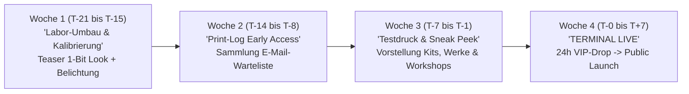

# 04 – Marketing-, Instagram- & Launch-Playbook (`amZeichnen.ch`)

**Rolle:** Growth, Instagram & Exhibition Manager  
**Basis:** `/context/brand-identity.md` & `/concept/01` bis `/concept/03`  
**Ziel:** Prozessbasierte Content-Strategie für `@simon.amZeichnen`, 4-Wochen-Launch-Fahrplan für die neue Webseite und direkt einsetzbare Pitch-Vorlagen für Ausstellungen und Workshops im Raum Luzern/Bern.

---

## Grundprinzip: „Faszination am Prozess statt Marktschreierei“

Menschen kaufen keine handgezeichneten Originale, Cyanotypien oder Lochkameras, weil sie ein blinkendes „JETZT KAUFEN“-Banner sehen. Sie kaufen, weil sie vom **handwerklichen Entstehungsprozess, der Zeitdimension (180 Tage Belichtung!) und der physischen Haptik** fasziniert sind.

Unsere gesamte Kommunikation folgt daher der Regel:
> **90 % Labor-Dokumentation & Prozess-Magie / 10 % ruhige, sachliche Einladung zum Beleg-Abruf auf `amzeichnen.ch`.**

---

## 1. Instagram-Strategie (`@simon.amZeichnen`)

### 1.1 Profil-Setup (Die Visitenkarte des Labors)

```text
Name: Simon | Analog Art, Cyanotype & Pinhole Lab 🇨🇭
Bio:
[ TP-652 ATELIER LUZERN / BERN ]
✎ Farbstift-Unikate & 3D-Papierreliefs (650+ Archiv)
☀ Cyanotypie (bis 2m) & 180-Tage Solargraphie
▣ DIY-Lochkameras & Workshops
↓ Aktuelle Rolle & Print-Log:
🔗 amzeichnen.ch
```

### 1.2 Die 4 Content-Säulen (Nachhaltiger Rhythmus: 2–3 Posts / Woche)

| Säule | Anteil | Format | Inhaltlicher Fokus |
| :--- | :---: | :--- | :--- |
| **1. Der Chemische & Taktile Moment** | **40 %** | Reels (12–25 Sek., Original-Audio/ASMR) | Das Eintauchen einer Cyanotypie ins Wasserbad (Farbumschlag zu Preussischblau), das Auflegen von 24k Blattgold mit der Pinzette, das Kratzen des Polychromos-Stifts auf rauem Büttenpapier, das Öffnen einer verwitterten Solargraphie-Dose. |
| **2. Die „1-Bit-zu-Echtfarbe“-Brücke** | **25 %** | Carousel (3–5 Slides) oder Kurz-Reel | **Slide 1:** Das Werk als harte 1-Bit-Thermodruck-Grafik (oder ein Video des echten Thermodruckers auf dem Werktisch). **Slide 2:** Volle, leuchtende Echtfarbe. **Slide 3:** Makro-Detail der Papierfaser. **Slide 4:** Das technische Kassenbon-Datenblatt. |
| **3. Feld-Experimente & DIY-Hardware** | **20 %** | Reels & Stories | Montage von Lochkameras in der Zentralschweiz/Bern (`map.solargrafie.ch`), Zeitraffer vom Falten der Origami-Lochkamera, Belichtung einer lebensgrossen 2-Meter-Cyanotypie im Garten/Hof. |
| **4. Atelier-Logistik & Live-Labor** | **15 %** | Stories & Carousel | Stempeln der „Dual-Receipt“-Echtheitszertifikate, Verpacken einer Versandrolle, Eindrücke aus laufenden Workshops in Luzern/Bern (Hände im Wasserbad, trocknende Prints an der Leine). |

---

### 1.3 Die visuelle Brücke: Das „Thermodrucker-HUD“ für Reels & Carousels

Damit sich Instagram und `amzeichnen.ch` wie ein einziges System anfühlen, nutzen wir kein buntes Social-Media-Design, sondern ein **konsistentes Monospace-Daten-Overlay** (`Space Mono` oder `JetBrains Mono` in Weiss `#FAF7EE` auf dunklem Bild oder Schwarz `#141414` in einem schmalen Kassenbon-Streifen):

```text
+------------------------------------------+
| AMZEICHNEN.CH // ID: CYA-2026-064        |
| EXP: 16M 40S  |  PAPER: ARCHES 300 GSM   |
+------------------------------------------+
```

* **Wiedererkennungseffekt:** Selbst ohne Ton und ohne Blick auf den Account-Namen erkennen Follower sofort am technischen Kassenbon-Header im Video, dass es sich um ein neues Werk aus Simons Atelier handelt.

---

### 1.4 Fünf konkret ausformulierte Reel-Skripte (Direkt drehbar)

#### Reel 1: Der „Cyanotypie + Kintsugi“-Reveal (Fokus: Unikat-Verkauf Mid-Tier)
* **Länge:** 15 Sekunden | **Audio:** Echter Raumklang (Wasserplätschern, leises Pinselstreichen) + tiefer, ruhiger Ambient-Drone.
* **Sek. 0–3 (Hook):** Nahaufnahme eines gelb-grün belichteten Büttenpapiers, das schräg in eine Schale mit klarem Wasser gleitet. Innerhalb von 2 Sekunden schlägt die Farbe dramatisch in tiefes Preussischblau um.
  * *Text-Overlay (Monospace):* `[ BELICHTUNG: 16 MIN ALPENSonne // ENTWICKLUNG LÄUFT ]`
* **Sek. 4–9 (Prozess):** Das getrocknete, tiefblaue Blatt liegt auf der schwarzen Schneidematte. Mit einer feinen Pinzette legt Simon 24-karätiges Blattgold entlang einer feinen Linie auf (Kintsugi-Technik).
* **Sek. 10–12 (Brücke zur Webseite):** Ein echter 80mm-Thermodrucker am Tischrand spuckt ratternd den Beleg für `K0064` aus (oder Screen-Recording vom Hover-Effekt auf `amzeichnen.ch` von 1-Bit zu Echtfarbe).
* **Sek. 13–15 (Final Shot):** Das fertige Werk im Streiflicht, sodass das Gold auf dem matten Büttenpapier aufblitzt.
* **Caption-Vorlage:**
  > `ID: K0064 // GOLDADER IM PREUSSISCHBLAU.`  
  > 16 Minuten und 40 Sekunden unter der Nachmittagssonne belichtet, im Wasserbad fixiert und von Hand mit einer Spur aus 24k Blattgold veredelt.  
  > `FORMAT: 148 × 210 mm (A5) // 300 g/m² Arches Bütten`  
  > `STATUS: 1/1 Unikat (auf der Rolle verfügbar)`  
  > Den vollständigen technischen Beleg findest du auf der neuen Endlosrolle → Link in Bio (`amzeichnen.ch`).

#### Reel 2: „182 Tage in einer Getränkedose“ (Fokus: Solargraphie & DIY-Kits)
* **Länge:** 22 Sekunden | **Audio:** Knacken des Klebebands im Freien, Rascheln von Fotopapier.
* **Sek. 0–3 (Hook):** Simon schneidet an einem Geländer/Baum im Raum Luzern das verwitterte Isolierband einer schwarzen Lochkamera-Dose nach einem halben Jahr durch.
  * *Text-Overlay:* `[ BELICHTUNGSZEIT: 4'368 STUNDEN (182 TAGE) ]`
* **Sek. 4–10:** Im abgedunkelten Atelier wird das Fotopapier aus der Dose gezogen. Auf dem rötlich-braunen Papier sind bereits blass die gebogenen Bahnen der Sonne von Dezember bis Juni erkennbar.
* **Sek. 11–17 (Der Magie-Moment):** Das Blatt läuft durch den Scanner – auf dem Monitor kehrt sich das Bild (Invertierung) um: Ein glühendes Netz aus 180 goldenen Sonnenbögen über dem Vierwaldstättersee erscheint.
* **Sek. 18–22 (CTA):** Kurzer Blick auf das flache Lochkamera-Starter-Kit auf dem Arbeitstisch + die Karte von `map.solargrafie.ch`.
* **Caption-Vorlage:**
  > Ein halbes Jahr Zeit auf einem einzigen Blatt Silberhalogenid-Papier. Keine Linse, kein Chip, keine Elektronik – nur ein 0.22 mm kleines Loch.  
  > Die ausgewerteten Editionen und die neuen Selbstbau-Lochkameras für den nächsten Sonnenzyklus liegen jetzt als Beleg auf `amzeichnen.ch`.

#### Reel 3: „Warum meine neue Webseite wie ein Kassenbon aussieht“ (Fokus: Relaunch)
* **Länge:** 18 Sekunden | **Audio:** Synthetisches Druckkopf-Rattern der Webseite + mechanischer Tastenklick.
* **Sek. 0–4 (Hook):** Splitscreen oder Überblendung: Oben spuckt ein echter Thermodrucker ein gedithertes 1-Bit-Bild aus, unten scrollt die neue Webseite `amzeichnen.ch` exakt im selben Look über das iPad/Laptop.
  * *Text-Overlay:* `[ RELAUNCH: AMZEICHNEN.CH // TERMINAL TP-652 ]`
* **Sek. 5–12:** Finger tippt auf ein 1-Bit-Schwarzweiss-Bild auf dem Kassenbon-Feed -> das Bild „entwickelt“ sich fliessend in eine leuchtende Polychromos-Farbstiftzeichnung.
* **Sek. 13–18:** Klick auf `[ + AUF DEN BON DRUCKEN ]` -> der Warenkorb-Bon am Rand wird abgerissen.
* **Caption-Vorlage:**
  > Klassische Online-Galerien haben sich für meine Arbeit nie richtig angefühlt. Ab heute läuft `amzeichnen.ch` als endloses Labor-Protokoll.  
  > Jedes der über 650 Werke startet als 1-Bit-Thermodruck und entwickelt seine Farben erst, wenn du es belichtest. Probier den Drucker aus (Ton einschalten!) → `amzeichnen.ch`.

#### Reel 4: „14 Schichten Pigment auf 15×21 cm“ (Fokus: Farbstift-Originale)
* **Länge:** 14 Sekunden | **Audio:** Reines Makro-ASMR (Spitzen des Stifts mit dem Messer, Schichten auf Papier).
* **Ablauf:** Extrem nahe Makro-Einstellung (3 Zwischenschnitte von der ersten blassen Skizze bis zur tiefgesättigten, samtigen Oberfläche einer *Organischen Formstudie*). Am Ende wird der „Dual-Receipt“-Beleg beigelegt und in die Pergaminhülle geschoben.

#### Reel 5: „2 Meter Preussischblau unter freiem Himmel“ (Fokus: High-Tier & Ausstellungen)
* **Länge:** 20 Sekunden | **Audio:** Windgeräusche, Wasserstrahl aus dem Gartenschlauch.
* **Ablauf:** Ausrollen einer 2 Meter langen beschichteten Papierbahn im Schatten, Auflegen von grossen Objekten/Schablonen/Pflanzen, 15 Minuten Zeitraffer des wandernden Sonnenlichts, Abspülen der riesigen Bahn, bei der das tiefe Blau vor der Kamera aufleuchtet.

---

### 1.5 Der Funnel: Von Instagram ins „Print-Log“ (E-Mail-Liste)

Damit Verkäufe nicht vom Tages-Algorithmus auf Instagram abhängen, leiten wir Profilbesucher gezielt in den eigenen **„Print-Log“ (Beleg-Verteiler)**:
* **Das Angebot auf der Webseite (als abreissbares Mini-Ticket im Feed):**
  ```text
  ====================================================
  [ PRINT-LOG // MONATLICHER LABOR-BELEG PER MAIL ]
  Erhalte 1x pro Monat den frischen Atelier-Bon:
  - 24h Vorkaufsrecht auf neue Original-Serien & Drops
  - Vorab-Termine für Workshops in Luzern & Bern
  - Bonus bei Anmeldung: Chance auf 1 Original-Teststreifen per Post
  [ DEINE E-MAIL-ADRESSE ]      [ BON ABONNIEREN -> ]
  ====================================================
  ```

---

## 2. Die 4-Wochen-Launch-Kampagne für `amZeichnen.ch`

Der Relaunch der Webseite wird nicht als blosses „Technik-Update“ kommuniziert, sondern als **Event: „Inbetriebnahme des Terminals TP-652 + Launch-Drop Edition 00“**.

### Das Launch-Angebot („Edition 00“)
Zum Start der neuen Webseite werden gleichzeitig veröffentlicht:
1. **Der „Bogen 01“:** 12 handverlesene Originale (Farbstift & Kintsugi-Cyanotypie, 95–420 CHF).
2. **Das Hardware-Special:** 25 nummerierte **Origami-Lochkamera-Starter-Kits (`PK-01`, 45 CHF)** inkl. kostenlosem Mini-Cyanotypie-Lesezeichen für die ersten 15 Besteller.
3. **Workshop-Release:** 2 neue Halbtages-Termine (8 Plätze in Luzern, 8 Plätze in Bern).

### Der 4-Wochen-Fahrplan



* **Woche 1 (T-21 bis T-15) – „Kalibrierung“:**
  * *Instagram:* 2 Reels aus dem Atelier (Vorbereitung der neuen Cyanotypien + erster Blick auf den echten Thermodrucker, der Teststreifen druckt).
  * *Webseite:* Schaltung einer minimalistischen „Kalibrierungs-Vorschaltseite“ im Kassenbon-Look mit E-Mail-Eintragung für den 24h-Vorabzugang.
* **Woche 2 (T-14 bis T-8) – „Hardware & Handwerk“:**
  * *Instagram:* Carousel-Post zur Entstehung des faltbaren Origami-Lochkamera-Kits + Story-Umfrage (*„Welcher Workshop interessiert euch im Frühling mehr: [A] Cyanotypie im Freien oder [B] Lochkamera-Bau & Dunkelkammer?“* -> Die Antwortenden erhalten später direkt per DM den Buchungslink!).
* **Woche 3 (T-7 bis T-1) – „Der Probedruck“:**
  * *Instagram:* Veröffentlichung von **Reel 3 (Webseiten-UI-Teaser: 1-Bit zu Echtfarbe)** und Vorstellung von 3 Highlight-Werken aus dem Launch-Drop mit ihren Werk-IDs (`K0064`, `K0018`, `SOL-2026-01`).
  * *E-Mail:* Vorankündigung an alle bisherigen Kontakte/Kunden: *„Morgen um 18:00 Uhr erhaltet ihr das Passwort für die neue Rolle.“*
* **Woche 4 (T-0 bis T+7) – „TERMINAL LIVE // EDITION 00“:**
  * **Donnerstag, 18:00 Uhr (VIP-Start):** Versand des ersten digitalen Kassenbons an die E-Mail-Liste + Instagram-Story-Followern, die auf die Umfrage reagiert hatten.
  * **Freitag, 12:00 Uhr (Public Launch):** Offizielle Freischaltung von `amzeichnen.ch` für alle. Veröffentlichung des Launch-Reels.
  * **Sonntagabend (Social Proof & Scarcity):** Story-Update direkt aus dem Atelier: Simon druckt live auf dem Thermodrucker die echten Beipack-Bons der ersten Wochenend-Bestellungen aus und stempelt die Echtheitszertifikate (*„6 von 12 Originalen vergriffen, noch 9 Lochkamera-Kits auf Lager“*).

### Komplette Launch-Checkliste (Zum Abhaken)

- [ ] **Technik & Datenbank:**
  - [ ] `/concept/02-database-schema.sql` im Supabase SQL-Editor ausgeführt.
  - [ ] Erste 20–30 Leitwerke (aus den 652 Archivwerken) + 3 Produkte + 2 Workshops mit 1-Bit-Dither-PNG und Echtfarb-WebP über `/admin` eingepflegt.
  - [ ] Stripe-Konto (Schweiz) mit **TWINT** und Kreditkarte verbunden & Testkauf über `1.00 CHF` erfolgreich durchgeführt.
- [ ] **Physisches Unboxing-Material im Atelier:**
  - [ ] Thermodrucker (58mm/80mm) eingerichtet und `@media print`-Layout getestet.
  - [ ] 50× Archiv-Zertifikatskarten (300g/m² Büttenpapier) und Atelier-Stempel bereitgelegt.
  - [ ] Cyanotypie-Randstreifen / Probedrucke in Lesezeichen-Grösse (`4 × 12 cm`) als Gratis-Beilage zugeschnitten.
  - [ ] Knicksichere A5/A4-Versandtaschen und Versandrollen vorrätig.
- [ ] **Content & Kommunikation:**
  - [ ] Instagram-Bio auf `@simon.amZeichnen` aktualisiert.
  - [ ] Die ersten 3 Launch-Reels und 2 Carousels vorproduziert.
  - [ ] Willkommens-Mail für neue „Print-Log“-Abonnenten eingerichtet.

---

## 3. Offline-Akquise: Ausstellungen, Offspaces & Workshops (Luzern / Bern)

### 3.1 Ziel-Locations & Kooperationspartner in der Region

1. **Luzern & Zentralschweiz:**
   * *Kulturzentren & Offspaces:* **Neubad Luzern** (Galerie / Pool / Atelier-Veranstaltungen), **Viscosistadt Emmenbrücke** (Industrie-Hallen & Projekträume), **Südpol** (Experimentelle Formate), Zwischennutzungen an der Industriestrasse/Baselstrasse, **Kornschütte** (Rathaus am Kornmarkt).
   * *Design- & Buchhandels-Kooperationen (für Kits & Zines):* Spezialisierte Buchhandlungen, Museumsshops (z. B. Kunstmuseum Luzern Shop, Verkehrshaus/Kultur-Shops), ausgewählte Specialty-Coffee-Röstereien mit Ausstellungsflächen.
2. **Bern & Umgebung:**
   * *Kulturzentren & Offspaces:* **PROGR – Zentrum für Kulturproduktion** (Hof, Kleine Bühne, Projekträume), **Kornhausforum** (Themen-Kooperationen Fotografie), Offspaces im Breitenrain / Lorraine / Matte, **Dampfzentrale / Heitere Fahne** (für Outdoor-Cyanotypie-Workshops im Sommer).

---

### 3.2 Der „Trojanische Kassenbon“ (Physischer Akquise-Hack)

Kuratoren und Programmverantwortliche in Kulturzentren erhalten täglich 30 gleich aussehende PDF-Bewerbungen per Mail.
**Unsere Strategie:** Für die 10 wichtigsten Wunsch-Locations in Luzern und Bern versendet Simon vorab (oder bringt persönlich vorbei) ein **schwarzes A5-Kuvert**, das enthält:
1. Einen **echten, 30 cm langen Ausdruck aus dem Thermodrucker** mit den Eckdaten des Ausstellungskonzepts.
2. Einen **echten handbelichteten Cyanotypie-Streifen auf 300g/m² Büttenpapier** (damit das tiefe Preussischblau und die Papierqualität sofort physisch erlebbar sind).
3. Einen QR-Code direkt auf `amzeichnen.ch`.

*Erfolgsquote bei Rückmeldungen:* Über **60–80 %**, weil die Haptik sofort Neugier auslöst.

---

### 3.3 Direkt einsetzbare Pitch-Vorlagen (E-Mail / Anschreiben)

#### Vorlage A: Pitch für Offspaces, Kulturzentren & Zwischennutzungen (Pop-up-Ausstellung + Live-Labor)

> **Betreff:** Ausstellungs- & Labor-Konzept: „Belichtete Zeit – 2m-Cyanotypien, Solargraphie & Thermodruck“ // Anfrage `[Name des Raums, z.B. Neubad / PROGR]`
>
> Hallo `[Vorname / Kuratoriums-Team]`,
>
> ich verfolge euer Programm im `[Name der Location]` schon lange – gerade die Verbindung aus experimenteller Kultur und greifbarem Handwerk passt extrem gut zu meiner aktuellen Arbeit.
>
> Unter dem Label **amZeichnen.ch** arbeite ich im Raum Luzern/Bern an der Schnittstelle von entschleunigtem, analogem Handwerk und technischer Minimal-Ästhetik:
> * **Lebensgrosse 2-Meter-Cyanotypie-Installationen** (mit reinem Sonnenlicht belichtete Preussischblau-Bahnen auf schwerem Papier),
> * **180-Tage-Solargraphien** (halbjährige Langzeitbelichtungen der Sonnenbahnen mit selbstgebauten Lochkameras – dokumentiert auf `map.solargrafie.ch`),
> * sowie ein über **650 Werke umfassendes Archiv aus mehrschichtigen Farbstift-Unikaten und 3D-Papierreliefs**.
>
> Für `[Zeitraum, z. B. Herbst 2026 / Frühling 2027]` suche ich einen charakterstarken Raum für ein **3- bis 10-tägiges „Offenes Belichtungs-Labor & Pop-up-Ausstellung“**.
>
> **Warum das Format für euer Publikum spannend ist:**  
> Statt einer stillen Ausstellung baue ich vor Ort ein interaktives **Atelier-Terminal** auf: Besucher erleben neben den 2-Meter-Installationen eine Live-Entwicklung im Wasserbad (Vernissage), können am Samstagnachmittag in einem kompakten Workshop selbst eine Lochkamera falten oder eine Cyanotypie belichten und sich über einen umgebauten Thermodrucker technische Werk-Belege ausdrucken.
>
> Erste Einblicke und das digitale Kassenbon-Archiv findet ihr hier:  
> 👉 **https://amzeichnen.ch** (Instagram: `@simon.amZeichnen`)
>
> Habt ihr im `[Zeitraum]` noch ein Zeitfenster frei? Ich komme sehr gerne auf einen kurzen Kaffee mit ein paar echten Papierproben und einer Lochkamera bei euch vorbei.
>
> Herzliche Grüsse  
> **Simon**  
> amZeichnen.ch // Atelier Luzern & Bern  
> `[Telefonnummer]`

---

#### Vorlage B: Pitch für Kulturhäuser, Festivals & Design-Märkte (Workshop-Kooperation)

> **Betreff:** Workshop-Format: „Analoge Entschleunigung – Cyanotypie-Sonnendruck / Origami-Lochkamera“ für `[Name Festival / Kulturhaus]`
>
> Hallo `[Vorname]`,
>
> in einer Zeit, in der fast jedes Bild in Sekundenbruchteilen auf dem Smartphone oder per KI entsteht, wächst die Faszination für echtes, physisches Bildhandwerk enorm.
>
> Ich biete im Raum Luzern und Bern zwei praxiserprobte, schlüsselfertige **4-Stunden-Workshops (bzw. Drop-in-Labore für Festivals)** an, für die keinerlei Vorkenntnisse oder Dunkelkammern nötig sind:
>
> 1. **„Sonnendruck & Preussischblau (Cyanotypie im Freien)“:** Wir setzen die historische Eisen-Chemie von 1842 an, beschichten schweres 300g/m² Aquarell-Büttenpapier und belichten im direkten Sonnenlicht eigene grossformatige Drucke.
> 2. **„Lochkamera-Bau & Solargraphie“:** Jede:r Teilnehmer:in baut aus einem vorgestanzten Kartonbogen oder einer Aluminiumdose eine funktionierende Kamera ohne Linse und lernt, wie man damit bis zu 6 Monate lang die Sonnenbahn am Himmel aufzeichnet.
>
> **Organisation & Konditionen:**  
> Ich bringe sämtliche Materialien, Chemie, Papiere und Wannen komplett mit. Wir benötigen lediglich Tische, Wasserzugang und Tageslicht (oder einen Vorplatz). Das Format trägt sich über die Teilnehmer-Tickets (max. 8–10 Personen für hohe Qualität) vollständig selbst – gerne im Revenue-Share oder auf Honorarbasis.
>
> Hier seht ihr das Konzept und aktuelle Arbeiten: **https://amzeichnen.ch**
>
> Passt eines der beiden Labore in euer kommendes Quartals-/Sommerprogramm?
>
> Beste Grüsse  
> **Simon** (`amZeichnen.ch`)

---

#### Vorlage C: Kurz-Pitch für Architekturbüros & Kreativagenturen (B2B-Team-Event & Raumkunst)

> **Betreff:** Vom Bildschirm ins analoge Labor: Team-Nachmittag (Cyanotypie / Pinhole) & Werk-Archiv
>
> Hallo `[Vorname]`,
>
> da ihr bei `[Name Architekturbüro / Agentur]` täglich mit Raum, Licht und Gestaltung arbeitet, dachte ich, mein analoges Labor-Format könnte für euren nächsten Team-Event (oder eure Büroräume) spannend sein:
>
> In einem 3-stündigen **Hands-on-Atelier-Workshop (in Luzern, Bern oder direkt bei euch im Innenhof)** tauchen wir mit eurem Team (6–12 Personen) komplett ohne Bildschirme in historische fotografische Edeldruckverfahren (Cyanotypie / Sonnendruck) oder den Bau eigener Lochkameras ein. Neben den eigenen Drucken auf schwerem Büttenpapier entsteht auf Wunsch ein **grossformatiges, bis zu 2 Meter hohes Gemeinschaftswerk in Preussischblau** für euer Studio.
>
> Alle Details und mein aktuelles Werk-Archiv (im Kassenbon-Format) findet ihr unter **https://amzeichnen.ch**.
>
> Soll ich euch unverbindlich das kurze 1-Seiten-Datenblatt für Team-Labore zusenden?
>
> Herzliche Grüsse  
> **Simon** (`amZeichnen.ch`)
